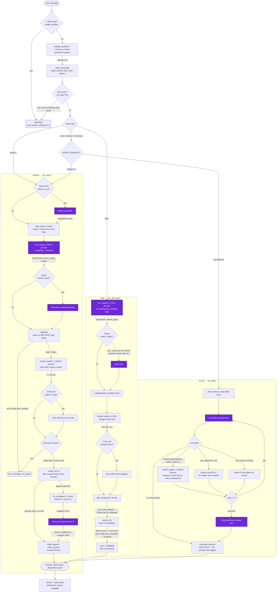

# Query pipeline

How one user message travels through the app, from the Chainlit handler to the answer on screen.

Everything here was read from the code in this folder. The deployed app is
**`threeofus_main.py` run under Chainlit** (`chainlit run threeofus_main.py`); `rag.py`, `chat.py` and
`chainlit_app.py` are earlier prototypes and are **not** part of this pipeline (see
[Other pipeline versions](#other-pipeline-versions)).

Three paths exist, chosen by the key the user typed:

| Typed | Path | Function |
|---|---|---|
| `search= <topic>` | fixed search pipeline | `run_query` |
| `title= <title>` | title lookup | `run_title_query` |
| anything else | tool-calling agent | `run_agent` |

---

## Flowchart



Purple boxes are LLM calls (all of them Ollama `qwen3:4b` by default, one model shared by every chain).
Diamonds are decisions made in code, not by a model.

---

## Stage table

`k` and line numbers refer to the files in this folder. "LLM?" names the Ollama model only where a call
actually happens; every call uses `OLLAMA_MODEL` (`.env`, e.g. `qwen3:4b`) at `NUM_CTX = 16384`.

### Entry and input checks (every message)

| Stage | File:Function | Input → Output | LLM? | Key params |
|---|---|---|---|---|
| GUI handler | `threeofus_main.py:2121` `gui_on_message` | Chainlit message → `SearchResponse` rendered as cards | no | reads `newest_first` pref from `history.db`; passes `shown` (last result's papers) and `known` (all papers in the chat) |
| Turn entry | `threeofus_main.py:1720` `run_turn` | raw string → `SearchResponse` | no | `AGENT_ENABLED` (`AGENT` env, default on) |
| 1. Length check | `prompt_cleaning.py:167` `length_problem` | raw string → error or `None` | no | `MAX_PROMPT_WORDS = 200`; counts only tokens with a letter/digit |
| 2. Symbol cleaning | `prompt_cleaning.py:68,75` `collapse_repeats`, `remove_symbols` | string → string | no | keeps `= , - : . ; ? ' &`; `...`→`.`, `–`→`-`, everything else → space |
| 3. Key parsing | `prompt_cleaning.py:96` `parse_message` | cleaned string → `ParsedMessage(mode_key, text, authors, year/year_from/year_to, errors)` | no | called with `current_mode=None` (**no mode memory**); `analyze=` parses but is routed to the agent |
| 4. Routing | `threeofus_main.py:1740-1754` | `mode_key` → one of three paths | no | `search`/`title` → fixed pipelines; everything else → agent; `AGENT=0` turns the message into `search= <text>` |

### Search path (`search=`) — `run_query` (`threeofus_main.py:1180`)

| Stage | File:Function | Input → Output | LLM? | Key params |
|---|---|---|---|---|
| 5. Follow-up rewrite | `threeofus_main.py:666` `rewrite_with_history` | prompt + up to 10 turn pairs → standalone query | **yes** — `REWRITE_PROMPT` (`:333-344`), `temperature=0`, `reasoning=False`, structured `RewriteResult` | runs **only** if history exists *and* `FOLLOWUP_CUE_RE` (`:96`) matches ("it", "those", "the second one", …); on failure or an output > `3*len+200` chars, the prompt is used as typed |
| 6. Author strip | `threeofus_main.py:724` `strip_author_names` | topic + `author=` names → topic without them | no | skipped in title mode; kept as-is if nothing would be left |
| 7. Spell check / topic extraction | `threeofus_main.py:691` `run_analyzer` → `:517` `spell_check_chain` | `{request (with keys), query}` → `TopicCheck(search_query, unclear, unclear_reason)` | **yes** — `ANALYZE_SYSTEM_PROMPT` (`:269-302`), `temperature=0`, `reasoning=False`, `format=TopicCheck` JSON schema, `PydanticOutputParser` | one retry with `ANALYZE_RETRY_NOTE` (`:322`) if `search_query` is empty; any exception → `regex_fallback` (`:407`), topic as typed |
| 8. Validation | `threeofus_main.py:418` `validate` | analysis + text → `QueryCheck(errors, warnings, diagnostics)` | no | `DB_FIRST_YEAR = 2007`, `DB_LAST_YEAR = 2026`; out-of-range exact year or `unclear=true` → **error, search skipped**; out-of-range range bounds → warning, filter dropped; topic longer than `1.5 ×` the prompt → regex topic |
| 9. Survey focus | `threeofus_main.py:1210` | topic text → `survey_focus: bool` | no | `SURVEY_WORD_RE` on the pre-LLM text; when true the research-paper pool is **empty by construction** (`:993`) and only surveys are shown |
| 10. Retrieval (×2) | `threeofus_main.py:977` `search_papers` → `retriever_hybrid_rrf.py:362` `retrieve` | topic → 2 lists of ≤ 20 `Evidence` | no | `K_RETRIEVE = 20` per search; query 1 = topic, query 2 = `"survey of <topic without 'survey'>"`; filters from `build_filters` (`:876`) |
| 10a. Hybrid + RRF | `retriever_hybrid_rrf.py:362-434` | query → 20 fused hits | no | dense `BAAI/bge-base-en-v1.5` (768d, prefixed `"Represent this sentence for searching relevant passages: "`) + sparse `Qdrant/bm25` (pruned: `MIN_SPARSE_WEIGHT = 0.30`, `MAX_SPARSE_TERMS = 35`); `prefetch_limit = max(50, 2k) = 50` per branch; **fusion is server-side `models.Fusion.RRF`** with `limit=20`. Two extra single-vector queries run first, only to record dense/sparse sub-ranks for diagnostics |
| 10b. Author fallback | `threeofus_main.py:1219-1230` | 0 hits + `author_keys` filter → retry | no | retries with `author_last_names` only; warns the user which names actually matched (`last_name_matches`, `:758`) |
| 11. Pool split | `threeofus_main.py:993-999` | 40 hits → paper pool + survey pool | no | a hit is a survey iff `"survey" in title.lower()` (`:808`); surveys are taken from **both** searches and deduped by `point_id`; papers only from the topic search |
| 12. Empty check | `threeofus_main.py:1238` | pools → error | no | error only when the survey pool is empty *and* (survey_focus or the paper pool is empty) |
| 13. Cross-encoder rerank (×2) | `threeofus_main.py:1022` `rerank_full` → `:1003` `rerank_hits` | (topic, [hits]) → hits best first + scores | no (cross-encoder, not generative) | `RERANKER_MODEL = BAAI/bge-reranker-base`, `max_length=512`, `batch_size=32`, fp16 on CUDA; scores the pair (topic, `title\n\nabstract`); on failure the Qdrant/RRF order is kept |
| 14. **N+2 fit** | `threeofus_main.py:1058` `fit_candidates` → `:1046` `fit_pool` | reranked papers → the 4 or 5 sent to the LLM | no | `MAX_PAPERS (N) = 3`, `MAX_EXTRA_CANDIDATES = 2`, `MIN_EXTRA_CANDIDATES = 1`; sends **N+2 = 5** if the rendered prompt + `RANKING_OUTPUT_RESERVE = 3000` tokens ≤ `NUM_CTX = 16384`, else **N+1 = 4** (and sends it anyway with a warning if even that is too big). Token estimate is `len/3.5`, no tokenizer |
| 15. Surveys shown | `threeofus_main.py:1253` | reranked surveys → top 5 | **no — surveys never reach an LLM** | `SURVEYS_SHOWN = 5` |
| 16. LLM pick | `threeofus_main.py:1107` `rank_pool` (called from `:1146` `rank_papers`) | 5 papers (title + abstract) → `PoolRanking(criteria, picks, why_best)` | **yes** — `RANK_POOL_PROMPT` (`:346-356`), `temperature=0.6`, `seed=42`, `reasoning=True`, `with_structured_output(..., include_raw=True)` | picks at most `MAX_PAPERS = 3`; `valid_picks` (`:824`) drops out-of-range/duplicate picks; any failure, unparsable output or empty pick list → **fallback to the reranker's top 3** and a user-visible warning |
| 17. Display order | `threeofus_main.py:1086,1092` `order_surveys`, `order_papers` | picks → 1-based display order | no | "Newest first" checkbox (per-user pref) sorts by year; otherwise LLM order for papers, reranker order for surveys |

### Title path (`title=`) — `run_title_query` (`threeofus_main.py:1315`)

| Stage | File:Function | Input → Output | LLM? | Key params |
|---|---|---|---|---|
| 5'. Title spell check | `threeofus_main.py:1323` → `:691` `run_analyzer` → `:544` `get_title_chain` | request → `TopicCheck.search_query` (title, wording preserved) | **yes** — `ANALYZE_TITLE_SYSTEM_PROMPT` (`:304-320`) | Same function and same chain factory as stage 7; only the system prompt differs (`:695`). `keep_wording=True` in `validate`, so `strip_filler` is skipped; no follow-up rewrite and no author stripping on this path. **Quirk:** the retry-on-empty at `:702` is not mode-aware — `get_retry_analyze_chain` (`:536`) is built from `ANALYZE_SYSTEM_PROMPT`, the *topic* prompt, so a title whose first call returns empty is retried with instructions to strip filler and return a research topic, contradicting the keep-every-word contract that `TITLE_EXACT` depends on |
| 6'. Retrieval | `threeofus_main.py:1341` | title → ≤ 100 hits | no | `K_TITLE = 100`; **years and authors are not filters here**, only an explicit `category:` is; if the category gives 0 hits it is dropped and the search repeats |
| 7'. Title similarity | `threeofus_main.py:1277` `title_similarity` | (query, hit title) → [0,1] | no | mean of `difflib` char ratio and word-level F1, on normalized titles (`normalize_title`, `:1269`) |
| 8'. Rerank pool | `threeofus_main.py:1361-1365` | 100 hits → ≤ 30 candidates, reranked | no | `TITLE_POOL_BY_SIM = 10` best by similarity + `TITLE_POOL_BY_QDRANT = 20` best by Qdrant, deduped; reranker scores clamped to [0,1]; on failure similarity alone decides |
| 9'. Blended score | `threeofus_main.py:1372-1380` `score` | candidate → float | no | `sim ≥ TITLE_EXACT (0.95)` → `10 + sim + bonus + 0.01·rr` (exact always wins); `sim ≥ TITLE_BLEND_MIN (0.60)` → `0.7·sim + 0.3·rr + bonus`; below → `0.3·sim + 0.7·rr + bonus`. Bonuses: `TITLE_AUTHOR_BONUS = 0.03`, `TITLE_YEAR_BONUS = 0.02` (year tolerance ±1) |
| 10'. Result | `threeofus_main.py:1383-1406` | ranked → exactly one paper | **no LLM ranking on this path** | non-exact match adds the warning "exact title match was not found" |

### Agent path (no key) — `run_agent` (`threeofus_main.py:1607`)

| Stage | File:Function | Input → Output | LLM? | Key params |
|---|---|---|---|---|
| 5''. History select | `threeofus_main.py:614` `select_history` | history + tags → turns worth re-reading | no | failed turns (`ok=False`, from `memory_tags`, `:599`) are dropped; `MAX_HISTORY_TURNS = 10` pairs |
| 6''. Tool loop | `threeofus_main.py:1630-1645` | messages → tool calls or an answer | **yes, up to 4 times** — `AGENT_SYSTEM_PROMPT` (`:1437-1456`), `temperature=0.2`, `reasoning=True`, `num_predict = AGENT_MAX_TOKENS = 4096`, `llm.bind_tools` | `AGENT_MAX_STEPS = 4`; the papers currently on screen are injected as an extra `SystemMessage` (`:1621-1624`) |
| 6''a. `search_papers` tool | `threeofus_main.py:1497-1545` | (query, author, year_from, year_to, k) → JSON papers | no | reuses stage 10 (two Qdrant queries, `K_RETRIEVE = 20` each), dedupes, reranks `pool[:AGENT_RERANK_POOL = 40]`, returns `k` (default `AGENT_DEFAULT_K = 5`, max `AGENT_MAX_K = 8`), abstracts cut to `AGENT_ABSTRACT_CHARS = 700`, ≤ 5 authors. Year bounds at/outside 2007–2026 are dropped; empty query + empty author is refused |
| 6''b. `get_paper` tool | `threeofus_main.py:1547-1578` | arXiv id → full abstract + all authors | no | looks in this turn's hits, then a Qdrant `scroll` by `arxiv_id`, then papers shown earlier in the chat; `AGENT_MAX_AUTHORS = 40` |
| 6''c. `list_current_results` | `threeofus_main.py:1580-1587` | — → labels/ids/titles on screen | no | marks those ids "vouched" so citing them is not flagged |
| 7''. Forced answer | `threeofus_main.py:1646-1652` | messages → final text | **yes** — plain `"Stop searching. Answer the question now…"`, no tools bound | only when the loop hits `AGENT_MAX_STEPS` |
| 8''. Citation check | `threeofus_main.py:1666-1695` | answer text → answer with `[1]`, `[2]` + paper cards | no | `CITATION_RE` (`:1460`); ids a tool returned become numbered cards; ids only shown earlier stay as the bare id; **anything else is rewritten to `[<id> (unverified)]`** and a warning is added |

### Side paths

| Path | Where | Notes |
|---|---|---|
| Startup health check | `threeofus_main.py:918` `health_check` (from `gui_start`, `:2096`) | pings Qdrant and reconnects if it died; reloads the reranker/embeddings only if missing; posts an empty Ollama request to preload the model. Reports "Ollama NOT available → searches will fall back to reranker order" instead of failing |
| Model caching | `:528,536,542,548,1601` `functools.lru_cache`; `:564,888` module globals + `threading.Lock` | one Ollama chat model, one retriever, one cross-encoder per server process; `_retriever_lock` serializes every Qdrant search, `_reranker_lock` every rerank |
| Early rejections | `:1701` `rejected` | length, "nothing but symbols", key errors (two mode keys, `year=19x`, empty `author=`). **No LLM call, no Qdrant call** |
| Reading list / export | `:2248` `gui_export` → `export.py` | writes the checked chunks as JSONL, then a zip with BibTeX + PDFs fetched from arXiv. Independent of retrieval |
| Diagnostics | `chatbot_diagnostics.py`; `start_context_tracking` / `llm_config` | per-stage notes, a rank trace per candidate (Qdrant rank → reranker rank → sent to LLM → picked) and token usage per LLM call, shown in a collapsible panel and saved with the chat |
| Accounts / prefs | `:1957` `gui_login`, `:2029-2032` routes | `/signup` and `/prefs/newest-first` are added in front of Chainlit's catch-all route |
| Eval harness | `eval/run_eval.py` | drives the **real** `run_turn`, so it exercises this same pipeline; `--mode-key none` tests the agent, `search` the fixed pipeline |

---

## Your list, checked

| # | Your stage | Verdict | Evidence |
|---|---|---|---|
| 1 | Query cleaning | **CONFIRMED** | `prompt_cleaning.py:68` `collapse_repeats`, `:75` `remove_symbols`, `:167` `length_problem`, `:96` `parse_message`; called in order at `threeofus_main.py:1726-1738` |
| 2 | LLM prompt / query rewriting | **PARTIALLY CORRECT** | There are **two different** LLM rewrites, not one. (a) *Follow-up rewrite* `threeofus_main.py:666`, conditional — only with history and a reference cue. (b) *Spell check / topic extraction* `:691`, which always runs on `search=`/`title=`. Neither runs on the agent path: the agent gets the cleaned message and writes its own tool queries |
| 3 | Three retrieval paths: title, search, open-ended | **CONFIRMED**, with one correction | `threeofus_main.py:1740-1769`. The "open-ended" path is not a retrieval strategy but a **tool-calling agent** (`run_agent`, `:1607`) that decides for itself how many searches to run. It is also the **default** — any message without `search=`/`title=` lands there, including `analyze=` and messages with two mode keys (`tests/test_router_agent.py:44-48`) |
| 4 | A decision step + RRF | **PARTIALLY CORRECT**, order wrong | Both exist but not as one stage and not there. The **decision** is key-based routing and happens *before* any retrieval (`:1740`), not after it. **RRF is inside every single retrieval call** — server-side in Qdrant, `models.FusionQuery(fusion=models.Fusion.RRF)` at `retriever_hybrid_rrf.py:410` — fusing the dense and BM25 branches of *one* query. It does **not** fuse the three paths, and it does not fuse the topic and survey searches (those are merged by plain dedupe, `threeofus_main.py:995-998`). The app never calls the module-level `rrf_rerank` (`retriever_hybrid_rrf.py:251`) or `relevance_gate` (`:281`): those belong to that file's standalone CLI |
| 5 | Reranker with "N+2" | **CONFIRMED** — see below | `threeofus_main.py:51`, `:1044-1066` |
| 6 | LLM reranking | **CONFIRMED, but narrower than you think** | `threeofus_main.py:1107` `rank_pool`. It runs **only for research papers on the `search=` path**. Surveys are shown straight from the cross-encoder (`:1150-1155`, "LLM ranking skipped"), the title path has no LLM ranking at all (`:1380`), and the agent ranks nothing — it just cites what its tools returned |

### What "N+2" is

It is real and it is yours: `MAX_EXTRA_CANDIDATES = 2` at `threeofus_main.py:51`, with the comment
*"the LLM sees up to N+2 reranked candidates per pool (N = number it may pick)"*.

- **N = `MAX_PAPERS` = 3**, the number of research papers the model is allowed to pick.
- `fit_pool` (`:1046`) walks `extra` down from 2 to 1 and renders the full ranking prompt for the top
  `N + extra` reranked papers. It keeps the first size whose estimated tokens fit
  `NUM_CTX (16384) − RANKING_OUTPUT_RESERVE (3000) = 13384`.
- So the LLM normally sees **5 candidates and picks 3**. Only if that prompt is too long does it drop to
  **N+1 = 4** (`MIN_EXTRA_CANDIDATES = 1`), and if even 4 does not fit, it is sent anyway with a
  `WARNING … TOO BIG` diagnostic (`:1065`).

So N+2 is **not** a property of the reranker. It is the *handoff size* between the cross-encoder and the
LLM picker: give the model slightly more candidates than it may choose, so it has something to reject.
The giveaway that it is a context-budget rule and not a quality rule is that the only thing that can
reduce it is token pressure.

### Stages in the code that your list is missing

1. **Hard input rejection** before anything runs — 200-word limit and the symbol filter can end the turn
   with no LLM and no Qdrant call (`:1726-1736`, `:1701`).
2. **Metadata key parsing → Qdrant filters.** `year=` / `author=` are parsed by regex, never by the LLM
   (deliberately: the docstring at `:117-118` says asking the small model for metadata "made it loop and
   return an empty topic"). They become hard `must` filter conditions (`retriever_hybrid_rrf.py:169-188`).
3. **Author-name stripping from the topic** (`:724`), so a name does not pollute the embedding and the
   reranker while it is already a filter.
4. **Validation against the database's coverage** (`:418`): 2007–2026. This can stop the pipeline before
   retrieval.
5. **Two retrievals per search, not one** (`:983-986`): the topic, plus `"survey of <topic>"`.
6. **Paper/survey pool split** (`:993-999`) — two independent pools that are reranked, sized and ranked
   separately.
7. **Author last-name fallback retry** (`:1219-1230`) when the first-initial filter returns nothing.
8. **Survey pool bypasses the LLM entirely** (`:1253`, `:1150`).
9. **Display reordering** by the "Newest first" preference (`:1086-1093`), applied after ranking.
10. **Citation verification** on the agent path (`:1666-1695`) — invented arXiv ids are labelled
    `(unverified)` and surfaced as a warning.
11. **Fallback layers at every stage**: analyzer → regex topic; reranker → Qdrant/RRF order; LLM picker →
    reranker's top 3; Ollama down → health check says so and searches still return results.

### Corrected order (search path)

```
length check → symbol cleaning → key parsing → ROUTING DECISION
  → [follow-up rewrite (LLM, conditional)]
  → author strip → spell check (LLM) → validation
  → retrieval ×2, each one dense + BM25 fused by RRF inside Qdrant
  → pool split (papers / surveys) → cross-encoder rerank ×2
  → N+2 sizing → LLM picks 3 papers        (surveys: skip, show top 5)
  → display order → cards + diagnostics
```

Two things move relative to your list: the decision step goes to the **front**, and RRF goes **inside**
retrieval rather than after it.

---

## Other pipeline versions

| File | Status |
|---|---|
| `threeofus_main.py` | **The deployed app.** README's run command and `eval/run_eval.py` both target it |
| `rag.py` | Prototype stand-in: word matching over a 5,520-paper sample, no embeddings, no LLM. Its own docstring calls it "a STAND-IN so the UI can be built and tested first" |
| `chat.py` | Prototype using **Google Gemini** (`langchain_google_genai`, `GOOGLE_API_KEY`) over the same retriever. Not Ollama, not wired into the app |
| `chainlit_app.py` | Prototype Chainlit UI with **no LLM at all**; defaults to a different collection (`sebun_bge384_persistent_full` vs the app's `sebun_bge768_hybrid_full`) |
| `retriever_hybrid_rrf.py` CLI (`main`, `search`, `run_case`, `:496-690`) | A second, standalone retrieval pipeline in the same file the app imports from. The app uses **only** `build_retriever`, `MetadataIntent`, `Evidence`, `split_payload` and `retrieve` |
| `utils/db_generator_hybrid_gpu.py` | Index build, not query time |

`README.md` lists the first three as "Earlier prototype, not used by the current app", which matches what
the imports show.

---

## Uncertainties

Things I could not settle from the code alone, or that the code and the docs disagree about.

1. **The RRF constant `k` is not visible here.** Fusion is done by the Qdrant server
   (`retriever_hybrid_rrf.py:410`); the app passes no fusion parameter and no per-branch weights, so the
   smoothing constant is whatever the server build uses. It cannot be tuned from this repo without
   replacing the fusion query. The only RRF knobs the app controls are `prefetch_limit = 50` per branch
   and `limit = K_RETRIEVE = 20`.
2. **`README.md` and `notes.md` describe an `analyze=` pipeline that no longer exists.** `notes.md:85-97`
   documents `run_analyze`, `ANALYZE_PROMPT`, `resolve_paper_refs`, `SINGULAR_REF_RE` and
   `ANALYZE_MAX_PAPERS`; none of those identifiers exist in any `.py` file. `ANALYZE_MAX_TOKENS` (README's
   options table) is likewise unused in code. `analyze=` now parses and is handed to the agent
   (`:1742-1743`). I diagrammed the code.
3. **README's "the mode stays on" is also stale.** `parse_message` still supports a remembered mode via
   `current_mode`, but both call sites pass `None` (`:1738`, `:2150`), and `run_turn`'s own docstring says
   "There are no remembered modes". The `from_memory` flag and its diagnostic line (`prompt_cleaning.py:124`)
   are therefore unreachable in the app.
4. **Streaming is wired up but dead.** `gui_on_message` builds an `on_token` callback and passes it to
   `run_turn` (`:2141-2155`), `run_turn` accepts it (`:1721`) — and never uses it. `stream_text` (`:1413`)
   is defined and never called. Agent answers are sent in one piece via `gui.send_notice` (`:2173`), so
   the `cl.Message` opened for streaming stays empty. Harmless, but the "answer streams to the GUI" line
   in `notes.md:97` is no longer true.
5. **Constants defined but never read**, all marked "(kept) old …" in their own comments:
   `K_SURVEYS` (`:46`), `K_SURVEYS_FOCUS` (`:47`), `EXTRA_CANDIDATES` (`:50`), `TITLE_CLOSE` (`:68`),
   `K_TITLE_RERANK` (`:73`). `K_FINAL` (`:45`) is read only by the `chat.py` prototype. I could not tell
   whether these are kept for reference or are leftovers.
6. **`SHOW_REASONING` only affects the CLI.** It is read at `:40` and used once, in `format_response`
   (`:1801`). The Chainlit path never calls `format_response` for search results, so setting
   `SHOW_REASONING=1` changes nothing in the browser.
7. **`category:` is parsed but can never filter a `search=` query.** `parse_category` (`:382`) extracts a
   code, but `validate` sets `a.category = None` (`:481`) before `build_filters` runs, and `analyze_query`
   re-attaches it afterwards (`:799`) — after the filters for the search path were already built from the
   validated analysis. On the **title** path the category *is* used (`:1338`). I read this as deliberate
   (the `QueryAnalysis` field is documented "Always null") but the dead `category:` branch in search mode
   looks like a leftover rather than a decision.
8. **The chars-per-token estimate is unverified.** `CHARS_PER_TOKEN = 3.5` (`:54`) is called "rough,
   conservative" in its comment; whether N+2 ever actually degrades to N+1 in practice depends on it and
   on real abstract lengths. I did not run the pipeline, so I cannot say how often that branch fires.
9. **`.env` was not read** (not present / not inspected), so the live `OLLAMA_MODEL`, `OLLAMA_NUM_CTX`,
   `AGENT`, `AGENT_MAX_STEPS` and `RERANKER_MODEL` values could differ from the defaults quoted above.
   Everything in this document assumes the defaults in `threeofus_main.py:34-66`.
10. **Not verified at runtime.** No code was executed, no Qdrant or Ollama instance was contacted. All
    shapes ("20 hits", "5 candidates") are what the code requests; actual counts depend on how many
    documents survive the filters.
